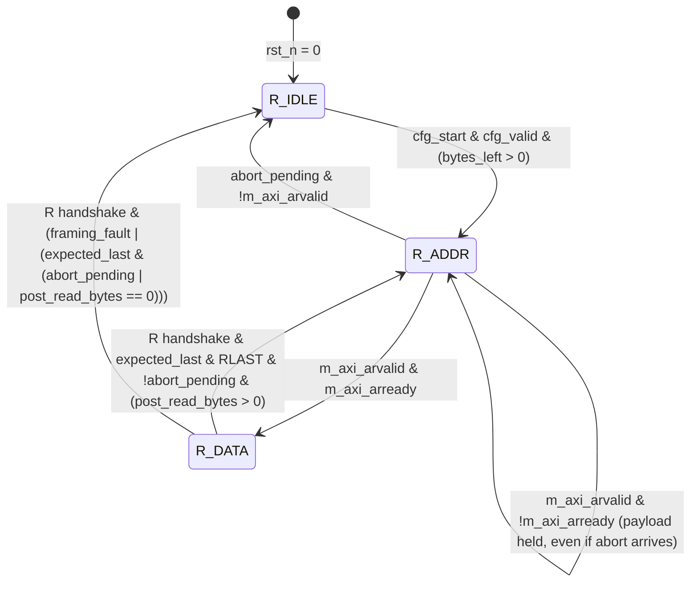
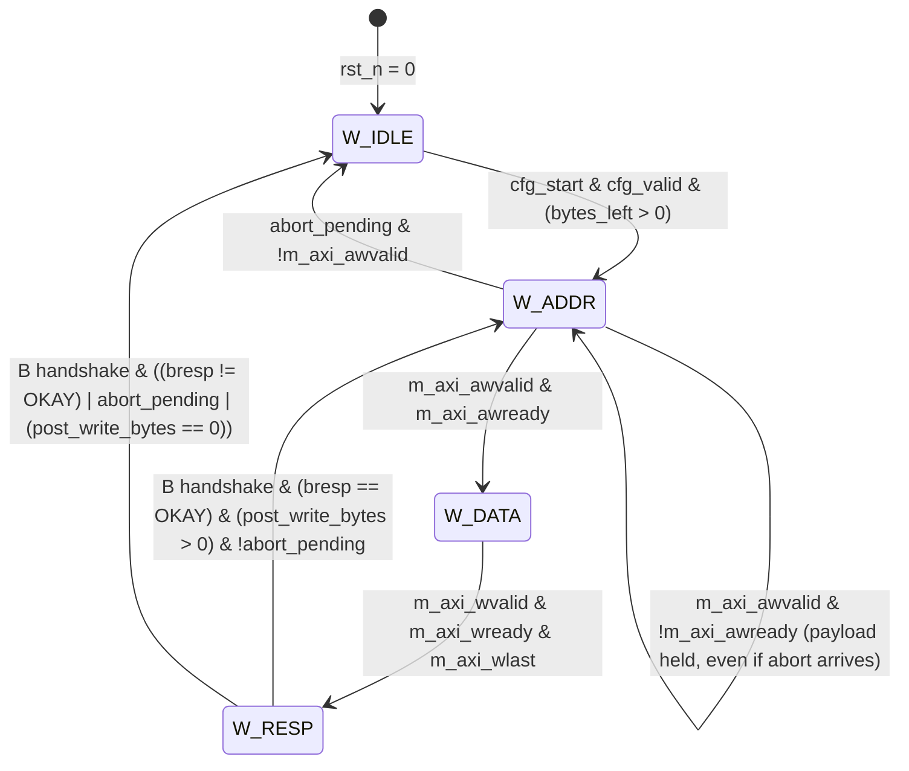
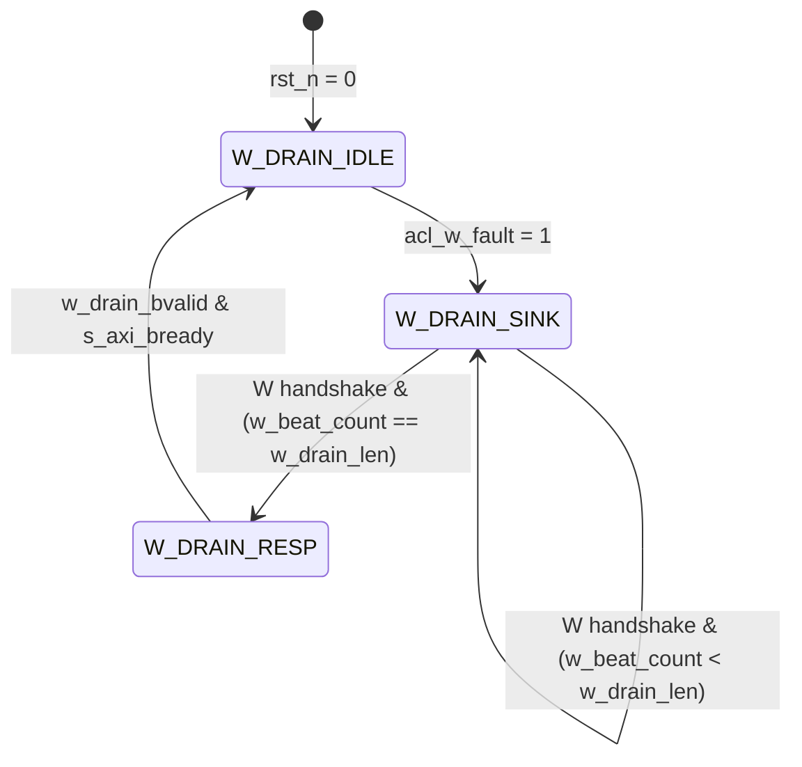
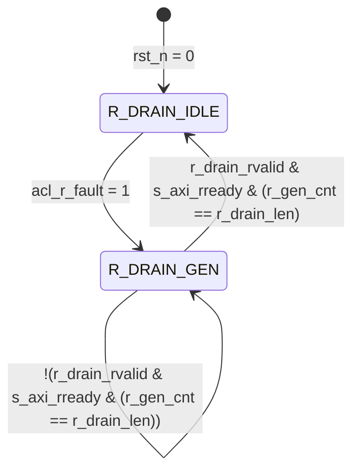
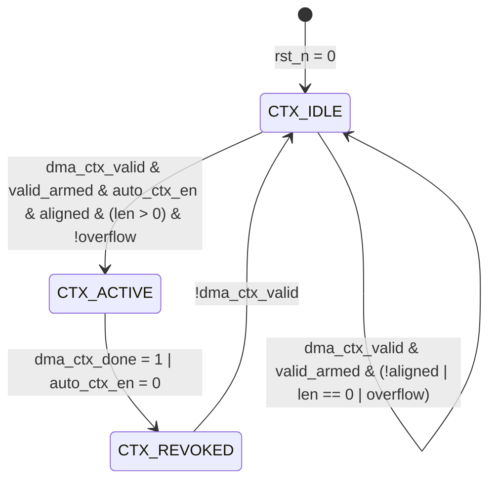

# ĐẶC TẢ CHI TIẾT CÁC MÁY TRẠNG THÁI (FSM SPECIFICATION)
## DMA-Aware Bus Firewall IP & DMA Controller Core
**Tài liệu:** Architecture Specification - Single Source of Truth (SSOT)
**Phiên bản:** V2.4.1 DMA-Constrained Clarification & Closure Baseline
**Ngày cập nhật:** 2026-08-23
**Trạng thái:** Canonical Architecture Baseline V2.4.1 — RTL Integrated / Frontend Verified

---

## 0. QUY TẮC ĐIỀU KHIỂN CHUNG V2.4.1 (NORMATIVE)

- **DMA-Constrained AXI Profile**: Chỉ chấp nhận `AxBURST=2'b01 (INCR)`, `AxSIZE=3'b010 (4B)`, `AxADDR[1:0]=2'b00 (Word-aligned)`, `AxLEN<=15 (Max 16 beats)`. Với mỗi burst: $\text{beats} = AxLEN + 1$, $\text{bytes\_beat} = 1 \ll AxSIZE$, $last\_byte = AxADDR + \text{beats} \times \text{bytes\_beat} - 1$; phép cộng phải có bit mở rộng để phát hiện overflow. Burst bị từ chối nếu trang 4KB của `AxADDR` khác trang 4KB của `last_byte`.
- **AXI Write Ordering & Backpressure**: DMA Master **tuyệt đối KHÔNG ĐƯỢC phát `WVALID` hoặc thực hiện handshake `W` trước khi `AW` handshake thành công (`AWVALID & AWREADY = 1`)**. Dưới backpressure (`AWREADY=0`), toàn bộ payload kênh AW (`awaddr, awid, awlen, awsize, awburst, awprot`) phải giữ nguyên ổn định.
- **Single Outstanding Limit**: Mỗi kênh đọc và ghi chỉ có tối đa một giao dịch outstanding tại bất kỳ thời điểm nào.
- **Fixed Trust Attributes**: DMA phát `ARID=AWID=4'h0` và `ARPROT=AWPROT=3'b001` (Secure, Privileged, Data). Firewall vẫn chốt/echo ID 4-bit cho response drain.
- **Address Acceptance versus Permission**: bắt tay `s_axi_AxVALID & s_axi_AxREADY` chốt request descriptor và ACL snapshot sau priority context/config; nó không phải tín hiệu cho phép. Stage 2 phát quyết định từ snapshot, và backpressure của Stage 2 phải truyền ngược để không ghi đè request đang giữ.
- **START Semantics**: `DMA_CTRL.START` là `WO` command pulse. Ghi 1 khi `BUSY=0` kích hoạt truyền; ghi 1 khi `BUSY=1` bị bỏ qua hoàn toàn (Ignored/No-op); đọc bit START luôn trả về 0. START **KHÔNG** tự động xóa cờ `DONE` hoặc `ERROR` trong `DMA_STATUS`.
- **Error Priority & Safe Termination**: Khi xảy ra lỗi (`RRESP != OKAY`, `BRESP != OKAY`, hoặc sai cấu hình), coordinator chốt `abort_pending`, không phát địa chỉ mới, hoàn tất/drain mọi burst đã được chấp nhận, rồi flush FIFO và phát terminal error event. Giao dịch lỗi không phát terminal done event; sticky `DONE` từ giao dịch trước, nếu chưa W1C, không bị tự động xóa và có thể cùng tồn tại với sticky `ERROR`.
- **Illegal-State Recovery**: Trạng thái không hợp lệ của mỗi FSM phải hạ toàn bộ output (valid/ready/strobe = 0) và khôi phục về trạng thái `IDLE` ở cạnh clock kế tiếp.

## 1. FSM 1: DMA READ MASTER FSM (`dma_axi_master.v`)

### 1.1. Mục Đích & Điều Kiện Hoạt Động
Điều khiển kênh AXI4 Read Master để đọc dữ liệu burst từ bộ nhớ nguồn và nạp vào bộ đệm Synchronous FIFO 32 words.
* **Clock Domain:** `clk` (một miền clock; baseline backend là 40 MHz với chu kỳ 25 ns trên Sky130A)
* **Reset:** `rst_n` (Active Low)
* **Trạng thái khởi tạo:** `R_IDLE (2'b00)`

### 1.2. Sơ Đồ Chuyển Trạng Thái (Mermaid State Diagram)


### 1.3. Bảng Chuyển Trạng Thái (State Transition Table)
| Trạng Thái Hiện Tại | Điều Kiện Đầu Vào (Input Conditions) | Độ Ưu Tiên | Trạng Thái Kế Tiếp | Hành Động & Cập Nhật Thanh Ghi |
| :--- | :--- | :---: | :---: | :--- |
| **`R_IDLE`** | `cfg_start == 1` và `cfg_valid == 1` | 1 | **`R_ADDR`** | Chốt `read_addr_ptr = cfg_src_addr`, `read_bytes_left = cfg_byte_len`, xóa `r_error_latched = 0`. |
| **`R_IDLE`** | `cfg_start == 1` và `cfg_valid == 0` | 2 | **`R_IDLE`** | Từ chối kích hoạt, phát xung `align_error_event = 1`, set sticky `ERROR`. |
| **`R_ADDR`** | `m_axi_arvalid==1` và `m_axi_arready==0` | 1 | **`R_ADDR`** | Giữ `ARVALID` và toàn bộ payload ổn định, kể cả khi `abort_pending` vừa được set; request đã present không được rút lại. |
| **`R_ADDR`** | `m_axi_arvalid & m_axi_arready` | 2 | **`R_DATA`** | Request trở thành committed; chốt `expected_r_beats=ARLEN+1`, xóa beat counter và phải retire theo số beat này. Nếu `abort_pending` đã set, discard toàn bộ returned data. |
| **`R_ADDR`** | (`read_bytes_left==0` hoặc `abort_pending==1`) và `m_axi_arvalid==0` | 3 | **`R_IDLE`** | Không tạo AR mới; báo `read_quiescent=1` cho coordinator. |
| **`R_ADDR`** | `!abort_pending` và `fifo_free >= burst_beats` | 4 | **`R_ADDR`** | Tính/chốt $ARLEN = \min(15, \text{beats\_left}-1, \text{beats\_to\_4KB}-1)$, assert `m_axi_arvalid`; payload được giữ đến handshake. |
| **`R_ADDR`** | `!abort_pending` và `fifo_free < burst_beats` | 5 | **`R_ADDR`** | Giữ `m_axi_arvalid=0`, tăng `read_stall_fifo_full_cycles`. |
| **`R_DATA`** | R handshake và (`m_axi_rresp != OKAY`, `RID != 0` hoặc lỗi đã chốt), với `RLAST == expected_last` | 1 | **`R_DATA`** hoặc **`R_IDLE`** | Chốt `r_error_latched=1`/`abort_pending=1`; không nạp beat lỗi và mọi beat sau lỗi vào FIFO; tiếp tục đến expected final beat rồi về `R_IDLE`. |
| **`R_DATA`** | R handshake và `RLAST != expected_last` | 2 | **`R_IDLE`** | Chốt framing error/abort; không push beat mismatch. `RLAST` sớm đóng kênh tại beat hiện tại; thiếu/trễ `RLAST` đóng kênh tại expected final beat. Không chờ thêm tín hiệu từ peer vi phạm. |
| **`R_DATA`** | R handshake, `expected_last && RLAST`, không lỗi và `post_read_bytes = read_bytes_left - burst_bytes > 0` | 3 | **`R_ADDR`** | Nạp beat cuối; cập nhật `read_addr_ptr += burst_bytes`, `read_bytes_left = post_read_bytes`. |
| **`R_DATA`** | R handshake, `expected_last && RLAST`, không lỗi và `post_read_bytes == 0` | 4 | **`R_IDLE`** | Nạp beat cuối, đặt `read_bytes_left=0`, hạ `m_axi_rready`; báo `read_quiescent=1`. |
| **`R_DATA`** | R handshake, `!expected_last && !RLAST`, `RRESP==OKAY`, `RID==0` và chưa có lỗi chốt | 5 | **`R_DATA`** | Nạp dữ liệu vào FIFO (`fifo_wr_en=1`), tăng beat counter và giữ `m_axi_rready=1`. |
| **`default`** | Trạng thái không hợp lệ (Illegal State) | - | **`R_IDLE`** | Phục hồi an toàn: hạ toàn bộ output về 0, quay về IDLE trong 1 clock cycle. |

### 1.4. Bảng Tín Hiệu Ngõ Ra Tổ Hợp Theo Trạng Thái (Output Table)
| Trạng Thái | `m_axi_arvalid` | `m_axi_rready` | `fifo_wr_en` | `r_busy_flag` |
| :---: | :---: | :---: | :---: | :---: |
| **`R_IDLE`** | `0` | `0` | `0` | `0` |
| **`R_ADDR`** | `1` (nếu đủ `fifo_free >= burst_beats`) | `0` | `0` | `1` |
| **`R_DATA`** | `0` | `1` | `m_axi_rvalid & m_axi_rready & (m_axi_rresp == OKAY) & !r_error_latched & !abort_pending` | `1` |

---

## 2. FSM 2: DMA WRITE MASTER FSM (`dma_axi_master.v`)

### 2.1. Mục Đích & Điều Kiện Hoạt Động
Điều khiển kênh AXI4 Write Master để xả dữ liệu từ FIFO 32 words ra bộ nhớ đích.
* **Trạng thái khởi tạo:** `W_IDLE (2'b00)`

### 2.2. Sơ Đồ Chuyển Trạng Thái (Mermaid State Diagram)


### 2.3. Bảng Chuyển Trạng Thái (State Transition Table)
| Trạng Thái Hiện Tại | Điều Kiện Đầu Vào (Input Conditions) | Độ Ưu Tiên | Trạng Thái Kế Tiếp | Hành Động & Cập Nhật Thanh Ghi |
| :--- | :--- | :---: | :---: | :--- |
| **`W_IDLE`** | `cfg_start == 1` và `cfg_valid == 1` | 1 | **`W_ADDR`** | Chốt `write_addr_ptr = cfg_dst_addr`, `write_bytes_left = cfg_byte_len`, xóa `w_error_latched = 0`. |
| **`W_ADDR`** | `m_axi_awvalid==1` và `m_axi_awready==0` | 1 | **`W_ADDR`** | Giữ `AWVALID` và toàn bộ payload ổn định, kể cả khi `abort_pending` vừa được set; tuyệt đối không phát W trước handshake. |
| **`W_ADDR`** | `m_axi_awvalid & m_axi_awready` | 2 | **`W_DATA`** | AW trở thành committed; phải phát đủ W beat và nhận B kể cả khi abort đã pending. |
| **`W_ADDR`** | (`write_bytes_left==0` hoặc `abort_pending==1`) và `m_axi_awvalid==0` | 3 | **`W_IDLE`** | Không tạo AW mới; báo `write_quiescent=1`. |
| **`W_ADDR`** | `!abort_pending` và `fifo_count >= burst_beats` | 4 | **`W_ADDR`** | Tính/chốt $AWLEN = \min(15, \text{beats\_left}-1, \text{beats\_to\_4KB}-1)$, assert `m_axi_awvalid`; payload giữ đến handshake. |
| **`W_ADDR`** | `!abort_pending` và `fifo_count < burst_beats` | 5 | **`W_ADDR`** | Giữ `m_axi_awvalid=0`; tuyệt đối không phát `WVALID`. |
| **`W_DATA`** | `m_axi_wvalid & m_axi_wready & m_axi_wlast` | 1 | **`W_RESP`** | Chốt xong beat cuối, chuyển sang chờ phản hồi ghi, bật `m_axi_bready = 1`. |
| **`W_DATA`** | `m_axi_wvalid & m_axi_wready & !m_axi_wlast` | 2 | **`W_DATA`** | Tăng `w_burst_cnt += 1`, lấy từ tiếp theo từ FIFO (`fifo_rd_en = 1`). |
| **`W_RESP`** | B handshake và `m_axi_bresp != OKAY` | 1 | **`W_IDLE`** | Chốt `w_error_latched=1`/`abort_pending=1`, không phát AW mới; báo `write_quiescent=1`. Sticky ERROR chỉ được set bởi terminal coordinator sau khi read outstanding đã drain và FIFO đã flush. |
| **`W_RESP`** | B handshake, `bresp==OKAY`, `post_write_bytes = write_bytes_left - burst_bytes > 0` và `!abort_pending` | 2 | **`W_ADDR`** | Cập nhật `write_addr_ptr += burst_bytes`, `write_bytes_left = post_write_bytes`. |
| **`W_RESP`** | B handshake, `bresp==OKAY` và (`post_write_bytes==0` hoặc `abort_pending`) | 3 | **`W_IDLE`** | Đặt `write_bytes_left=post_write_bytes`; không tự set DONE. Báo `write_quiescent=1` để coordinator quyết định terminal success/error. |
| **`default`** | Trạng thái không hợp lệ (Illegal State) | - | **`W_IDLE`** | Phục hồi an toàn: hạ toàn bộ output về 0, quay về IDLE trong 1 clock cycle. |

### 2.4. Terminal / Abort Coordinator (Normative)

Coordinator có thể được hiện thực trong `dma_axi_master.v` hoặc `dma_controller.v`, nhưng hành vi quan sát được phải như sau:

1. `START` hợp lệ khi idle chốt descriptor active, set `BUSY` và `dma_ctx_valid`; `START` khi busy không đến coordinator.
2. Lỗi cấu hình trước khi bắt đầu không phát AXI; phát terminal error event và không kích hoạt context.
3. `RRESP/BRESP != OKAY`, response ID mismatch hoặc RLAST framing mismatch chốt `abort_pending` cho đến terminal. Không được **tạo/present** AR/AW mới. AR/AW đã assert VALID trước khi abort không được rút lại; nó giữ payload đến handshake và khi handshake sẽ được xem là committed.
4. AR committed được retire theo `ARLEN+1` handshakes và phải có RLAST đúng expected final beat. Với peer tuân thủ, đây chính là drain đến RLAST. Nếu peer vi phạm bằng RLAST sớm hoặc thiếu/trễ RLAST, engine đóng read channel hữu hạn theo quy tắc FSM 1 và kết thúc lỗi thay vì chờ vô hạn. AW committed phải được cấp đủ W beats, nhận B, và giữ payload hợp lệ dưới backpressure. Chỉ sau khi hai engine quiescent mới flush FIFO residual.
5. Thành công khi `read_bytes_left==0`, `write_bytes_left==0`, hai engine quiescent và FIFO empty: hạ `BUSY/dma_ctx_valid`, pulse `dma_ctx_done`, phát `done_set_event` và không phát `error_set_event`.
6. Abort khi hai engine quiescent và FIFO đã flush: hạ `BUSY/dma_ctx_valid`, pulse `dma_ctx_done`, phát `error_set_event` và không phát `done_set_event`.
7. `done_set_event` và `error_set_event` loại trừ nhau trong cùng chu kỳ. Chúng không tự xóa sticky status đã có từ các giao dịch trước.

---

## 3. FSM 3: FIREWALL WRITE DRAIN FSM (`fw_drain_fsm.v`)

### 3.1. Mục Đích & Điều Kiện Hoạt Động
Tiêu thụ và hủy bỏ dữ liệu ghi bị từ chối với tối đa một handshaken beat mỗi chu kỳ, sau đó trả về phản hồi AXI (`DECERR` hoặc `OKAY`). FSM hoàn tất khi peer tuân thủ tiến trình AXI; không dùng timeout để giả lập `WLAST` hoặc trả B trước khi nhận đủ burst.
FSM được hiện thực trong `fw_write_drain.v` và được `fw_drain_fsm.v` instantiate. Wrapper không chia sẻ state với read drain.
* **Trạng thái khởi tạo:** `W_DRAIN_IDLE (2'b00)`

### 3.2. Sơ Đồ Chuyển Trạng Thái (Mermaid State Diagram)


### 3.3. Bảng Chuyển Trạng Thái (State Transition Table)
| Trạng Thái Hiện Tại | Điều Kiện Đầu Vào | Độ Ưu Tiên | Trạng Thái Kế Tiếp | Hành Động & Tín Hiệu Xuất |
| :--- | :--- | :---: | :---: | :--- |
| **`W_DRAIN_IDLE`** | `acl_w_fault == 1` | 1 | **`W_DRAIN_SINK`** | Chốt `w_drain_bid=acl_w_id`, `w_drain_len=acl_w_len`, `w_drain_err_mode=acl_w_err_mode`; đặt `w_beat_count=0`, bật `w_drain_wready=1`. Các giá trị `acl_w_*` đến từ request snapshot, không đọc live bus AW. |
| **`W_DRAIN_IDLE`** | Ngược lại | 2 | **`W_DRAIN_IDLE`** | Giữ `w_drain_wready = 0`, `w_drain_bvalid = 0`. |
| **`W_DRAIN_SINK`** | W handshake và `w_beat_count == w_drain_len` | 1 | **`W_DRAIN_RESP`** | Nuốt beat thứ `AWLEN+1`, kiểm `WLAST==1`, hạ `w_drain_wready=0`, phát `w_drain_bvalid=1`, `w_drain_bid` đã chốt và response theo `w_drain_err_mode`. Nếu `WLAST=0`, phát `w_framing_fault_valid=1` với code `WRITE_ERR + PROT_ERR`; vẫn đã nhận đủ số beat theo AWLEN. |
| **`W_DRAIN_SINK`** | W handshake và `w_beat_count < w_drain_len` | 2 | **`W_DRAIN_SINK`** | Nuốt beat, tăng `w_beat_count`. Nếu `WLAST=1` sớm, phát `w_framing_fault_valid=1` với code `WRITE_ERR + PROT_ERR`, không phát B sớm và vẫn chờ đủ số beat đã khai báo. |
| **`W_DRAIN_SINK`** | Không có W handshake | 3 | **`W_DRAIN_SINK`** | Giữ counter và mọi state; completion phụ thuộc AXI progress assumption. |
| **`W_DRAIN_RESP`** | `w_drain_bvalid & s_axi_bready` | 1 | **`W_DRAIN_IDLE`** | Hoàn tất bắt tay phản hồi, xóa `w_drain_bvalid`; `w_drain_bid/bresp` giữ ổn định trong toàn bộ stall. |
| **`default`** | Trạng thái không hợp lệ (Illegal State) | - | **`W_DRAIN_IDLE`** | Phục hồi an toàn: hạ toàn bộ output về 0, quay về IDLE trong 1 clock cycle. |

Số beat được chấp nhận trong `W_DRAIN_SINK` phải đúng `AWLEN+1`. `WLAST` sớm hoặc không có trên beat cuối là protocol fault bổ sung. Early `WLAST` không kết thúc burst sớm; thiếu các beat còn lại vi phạm progress assumption nên không có bounded-completion guarantee. Sau khi đã nhận đủ `AWLEN+1` beat, FSM trả B kể cả khi WLAST cuối sai, vì AWLEN là chiều dài đã cam kết. Mọi W beat dư sau đó không thuộc transaction này và không được nhận khi FSM ở `RESP/IDLE` nếu chưa có AW fault mới.

`w_framing_fault_valid` là pulse một chu kỳ và `w_framing_fault_code=4'b0110`. `dma_bus_firewall` ghép pulse với immutable write-owner `AWADDR/AWID/AWLEN/AWSIZE` giữ từ denied decision đến B handshake. Write drain không nhận address hoặc size.

---

## 4. FSM 4: FIREWALL READ DRAIN FSM (`fw_drain_fsm.v`)

### 4.1. Mục Đích & Điều Kiện Hoạt Động
Sinh đúng $ARLEN+1$ beat dữ liệu đọc ngụy trang $RDATA = 0x00000000$ kèm phản hồi `DECERR` (hoặc `OKAY` ở Honeypot Mode). `RVALID/RDATA/RRESP/RLAST/RID` phải giữ ổn định khi `RREADY=0`; wall-clock completion phụ thuộc progress của peer.
FSM được hiện thực trong `fw_read_drain.v` và được `fw_drain_fsm.v` instantiate. Read state tiến triển độc lập với write drain.
* **Trạng thái khởi tạo:** `R_DRAIN_IDLE (1'b0)`

### 4.2. Sơ Đồ Chuyển Trạng Thái (Mermaid State Diagram)


### 4.3. Bảng Chuyển Trạng Thái (State Transition Table)
| Trạng Thái Hiện Tại | Điều Kiện Đầu Vào | Độ Ưu Tiên | Trạng Thái Kế Tiếp | Hành Động & Tín Hiệu Xuất |
| :--- | :--- | :---: | :---: | :--- |
| **`R_DRAIN_IDLE`** | `acl_r_fault == 1` | 1 | **`R_DRAIN_GEN`** | Chốt `r_drain_len=acl_r_len`, `r_drain_rid=acl_r_id`, `r_drain_err_mode=acl_r_err_mode`; xóa `r_gen_cnt=0`. Các giá trị đến từ request snapshot, không đọc live bus AR. |
| **`R_DRAIN_IDLE`** | Ngược lại | 2 | **`R_DRAIN_IDLE`** | Giữ `r_drain_rvalid = 0`. |
| **`R_DRAIN_GEN`** | `r_drain_rvalid & s_axi_rready` và `r_gen_cnt == r_drain_len` | 1 | **`R_DRAIN_IDLE`** | Handshake beat cuối với `r_drain_rlast=1`, `r_drain_rid` đã chốt; hoàn tất đúng `ARLEN+1` beat. |
| **`R_DRAIN_GEN`** | `r_drain_rvalid & s_axi_rready` và `r_gen_cnt < r_drain_len` | 2 | **`R_DRAIN_GEN`** | Tăng `r_gen_cnt += 1`, phát dữ liệu `0x00000000`, giữ `r_drain_rvalid=1`. |
| **`R_DRAIN_GEN`** | `s_axi_rready == 0` | 3 | **`R_DRAIN_GEN`** | Giữ ổn định `RVALID/RDATA/RRESP/RLAST/RID` và counter. |
| **`default`** | Trạng thái không hợp lệ (Illegal State) | - | **`R_DRAIN_IDLE`** | Phục hồi an toàn: hạ toàn bộ output về 0, quay về IDLE trong 1 clock cycle. |

---

## 5. FSM 5: DYNAMIC CONTEXT TRACKER FSM (`fw_context_tracker.v`)

### 5.1. Mục Đích & Điều Kiện Hoạt Động
Giám sát kênh Sideband từ DMA Core, tự động cấp phát Region 4 (Read-Only) & Region 5 (Write-Only), và thực hiện thu hồi quyền đồng bộ trong đúng 1 chu kỳ clock sau khi lấy mẫu `dma_ctx_done`.
* **Trạng thái khởi tạo:** `CTX_IDLE (2'b00)`

### 5.2. Sơ Đồ Chuyển Trạng Thái (Mermaid State Diagram)


### 5.3. Bảng Chuyển Trạng Thái (State Transition Table)
| Trạng Thái Hiện Tại | Điều Kiện Đầu Vào | Độ Ưu Tiên | Trạng Thái Kế Tiếp | Hành Động Phân Quyền |
| :--- | :--- | :---: | :---: | :--- |
| **Mọi state** | `dma_ctx_done == 1` hoặc accepted APB write làm `AUTO_CTX_EN:1->0` | 1 | **`CTX_REVOKED`** | Xóa Region 4/5 tại cạnh đó. `done` có ưu tiên cao nhất; ACL snapshot cùng cạnh nhìn thấy region đã inactive. |
| **`CTX_IDLE`** | `dma_ctx_valid==1`, `valid_armed==1`, `AUTO_CTX_EN==1`, src/dst/len 4-byte aligned, `len>0`, không tràn | 2 | **`CTX_ACTIVE`** | Chốt descriptor một lần; Region 4=`[src,src+len-1]`, Read-Only; Region 5=`[dst,dst+len-1]`, Write-Only; cả hai `SECURE_ONLY=1`, `PRIV_ONLY=1`, `MID=0`, `MASK=0`, `ACTIVE=1`; hạ `valid_armed`. ACL snapshot cùng cạnh được phép thấy cấu hình mới. |
| **`CTX_IDLE`** | `dma_ctx_valid==1`, `valid_armed==1` và (misaligned hoặc `len==0` hoặc tràn địa chỉ) | 3 | **`CTX_IDLE`** | Không active region; phát một context-fault record với `BOUND_ERR`; hạ `valid_armed` để không đếm lặp mỗi chu kỳ. |
| **`CTX_IDLE`** | `dma_ctx_valid==0` | 4 | **`CTX_IDLE`** | Đặt `valid_armed=1`, sẵn sàng cho descriptor kế tiếp. |
| **`CTX_ACTIVE`** | Không có `done` và `AUTO_CTX_EN==1` | 2 | **`CTX_ACTIVE`** | Giữ nguyên descriptor; bỏ qua `dma_ctx_valid` lặp lại, không tái nạp giữa transfer. |
| **`CTX_REVOKED`** | `dma_ctx_valid==0` | 1 | **`CTX_IDLE`** | Xóa sạch descriptor, re-arm giao thức valid. |
| **`CTX_REVOKED`** | `dma_ctx_valid==1` | 2 | **`CTX_REVOKED`** | Không tự cấp phát lại từ mức valid cũ; chờ nguồn hạ valid. |
| **`default`** | Trạng thái không hợp lệ (Illegal State) | - | **`CTX_IDLE`** | Phục hồi an toàn: xóa Region 4 & 5, hạ toàn bộ output về 0, quay về IDLE. |

### 5.4. SVA Assertion Chuẩn hóa V2.4.1
```systemverilog
// Zero-Delay Revocation Assertion
property p_zero_delay_revocation;
    @(posedge clk) disable iff (!rst_n)
    dma_ctx_done |=> (!dyn_rgn4_active && !dyn_rgn5_active);
endproperty
assert_zero_delay_revocation: assert property (p_zero_delay_revocation);
```
