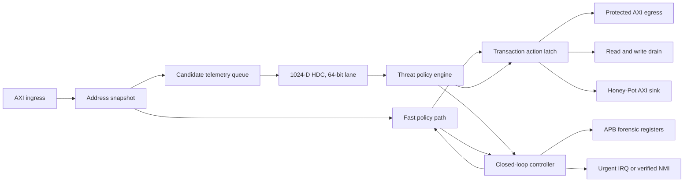

# AEGIS-RISC: đặc tả kiến trúc ASIC Sky130

## Hệ thống phát hiện, cô lập và phục hồi phối hợp cho DMA bus

| Thuộc tính | Giá trị chuẩn |
|---|---|
| Mã dự án | AEGIS-RISC |
| Phiên bản kiến trúc | 2.0.0 |
| Trạng thái | Bản đặc tả triển khai chờ chủ dự án rà soát nội dung |
| Công nghệ đích | Sky130A |
| Thư viện standard cell | `sky130_fd_sc_hd` |
| Operating Envelope Sign-off | TT: tối đa 38.00 MHz (26.315 ns) theo `WAV-STA-003`; SS: tối đa 19.23 MHz (52.000 ns) theo `WAV-STA-001` |
| Cold-Boot Sequencing | Bắt buộc reset warm-up 16 chu kỳ clock khi T < 0°C theo `WAV-STA-002` |
| Clock khảo sát & stress | 40.00 MHz (25 ns) là điểm biên chịu tải bảo thủ (pre-derating stress target); 150 MHz là mục tiêu khảo sát; tuyệt đối không quảng bá 40 MHz là điểm sign-off vận hành thương mại |
| Bus dữ liệu | AXI4 constrained profile, địa chỉ và dữ liệu 32 bit |
| Bus điều khiển | APB4 |
| CPU tích hợp | PicoRV32 |
| Toolchain tham chiếu | Verilator, Icarus Verilog, Yosys, SymbiYosys, OpenLane/OpenROAD, OpenSTA, Magic hoặc KLayout, Netgen |

## 1. Kết luận kiến trúc

AEGIS-RISC dùng hai đường xử lý độc lập. Fast path kiểm tra luật truy cập và phản ứng với vi phạm đã xác định. Analysis path dùng HDC 1024 chiều để đánh giá telemetry đáng ngờ mà không nằm trên critical path AXI.

HDC có độ rộng logic 1024 bit nhưng chỉ dùng một lane vật lý 64 bit. Lane được tái sử dụng qua 16 chunk cho mỗi prototype. Ba prototype được so sánh tuần tự bằng cùng một popcount unit. Safe traffic không chờ kết quả HDC và không nhận thêm stall từ analysis path.

Thiết kế chỉ nhắm ASIC Sky130. Các khái niệm LUT, DSP, BRAM, FPGA primitive và portability giữa các họ FPGA không thuộc baseline này. Mọi tuyên bố area, timing và power phải lấy từ cùng một flow Sky130 post-route, cùng PDK, library, constraint, activity và source manifest.

Tài liệu này là nguồn chuẩn cho kiến trúc AEGIS-RISC Sky130. `docs/AEGIS_SPEC_BASELINE.md` và `docs/superpowers/specs/2026-09-16-portable-fpga-asic-ppa-design.md` được giữ làm tài liệu lịch sử; các yêu cầu FPGA và register map `0x090/0x094/0x098` trong hai tài liệu đó không áp dụng cho baseline 2.0.0.

## 2. Mục tiêu và giới hạn

### 2.1. Mục tiêu bắt buộc

- Giữ AXI đúng giao thức dưới backpressure, deny, drain, rate limit và Honey-Pot.
- Cho safe traffic đi qua với throughput ổn định và không phụ thuộc trạng thái HDC.
- Phản ứng một chu kỳ sau khi fast path đạt điều kiện phát hiện, không tuyên bố phát hiện ngay từ giao dịch đầu tiên của một chuỗi tấn công.
- Theo dõi vi phạm riêng cho từng Master ID.
- Cung cấp telemetry, forensic record và cơ chế phục hồi qua APB4.
- Tổng hợp, place-and-route và kiểm tra vật lý bằng Sky130A với `sky130_fd_sc_hd`.
- Giảm area và dynamic power so với AEGIS baseline hiện tại mà không làm giảm coverage chức năng hoặc timing yêu cầu.

### 2.2. Ngoài phạm vi

- FPGA synthesis, FPGA place-and-route và primitive của bất kỳ FPGA vendor nào.
- Mô hình mật mã. LFSR và scrambler không được gọi là khóa bảo mật.
- Tuyên bố phát hiện mọi hardware Trojan. AEGIS chỉ quan sát hành vi thể hiện trên các tín hiệu bus và CPU telemetry đã nối vào thiết kế.
- Tuyên bố phát hiện Rowhammer vật lý khi chưa có ánh xạ địa chỉ DRAM bank/row đã kiểm chứng.
- Tuyên bố tapeout-ready chỉ từ RTL simulation, Yosys synthesis hoặc timing tại corner TT.
- Thiết kế DRAM controller, analog PHY, pad ring hoặc package.

### 2.3. Thuật ngữ

- `Fast path`: đường quyết định đồng bộ nằm trên pipeline giao dịch AXI.
- `Analysis path`: đường telemetry sideband, không điều khiển handshake của safe traffic.
- `Containment`: drain, rate limit, redirect hoặc quarantine để giới hạn tác động.
- `Recovery coordination`: thông báo CPU, lưu forensic và chờ phần mềm xác nhận hoặc giải phóng quarantine.
- `NMI`: chỉ được dùng khi đường CPU đã được chứng minh không thể bị firmware mask. Nếu chưa có bằng chứng này, tín hiệu phải được mô tả là urgent IRQ.

## 3. Mô hình đe dọa

| Mối đe dọa | Tín hiệu quan sát | Coverage được phép tuyên bố | Phản ứng chính |
|---|---|---|---|
| Truy cập sai ACL, MID hoặc PROT | AXI address channel và region policy | Phát hiện tất định | Deny và drain |
| Burst sai profile hoặc crossing 4 KiB | `AxADDR`, `AxLEN`, `AxSIZE`, `AxBURST` | Phát hiện tất định | Deny và drain |
| Master hợp lệ có hành vi bất thường | Tần suất, địa chỉ, streak và MID | Phát hiện trong phạm vi trace đã kiểm chứng | Rate limit, redirect hoặc quarantine |
| Timing probe | Khoảng cách thời gian và mẫu lặp | Phát hiện theo ngưỡng và prototype đã version hóa | Constant-time shaping hoặc rate limit |
| Row-thrashing | Row index logic và mẫu luân phiên | Phát hiện hành vi truy cập giống Rowhammer | Redirect hoặc drain |
| Rowhammer vật lý | Bank/row mapping của memory controller | Chỉ tuyên bố khi `DRAM_MAP_VALID=1` và mapping có test | Redirect, drain và quarantine |
| Bus starvation | Stall streak, occupancy và request rate | Phát hiện theo ngưỡng đã kiểm chứng | Rate limit và urgent IRQ |
| CPU telemetry breach | Trap hoặc stall nghiêm trọng từ CPU | Phát hiện tất định | Drain, quarantine và urgent IRQ |
| Rare-trigger Trojan | Chỉ những hành vi tạo sai khác quan sát được trên bus | Không tuyên bố coverage tổng quát | Ghi forensic khi có anomaly quan sát được |

Một báo cáo false-positive phải ghi số sự kiện, workload, seed và số lần nhận nhầm. Cụm từ `0% false positive` chỉ hợp lệ dưới dạng `0/N` trên tập kiểm tra nêu rõ hoặc dưới một property formal có assumptions được liệt kê.

## 4. Kiến trúc tổng thể



### 4.1. Luồng giao dịch

1. Address slice nhận AW hoặc AR handshake và chốt toàn bộ metadata cần thiết.
2. Fast path đánh giá ACL, profile, boundary, quarantine và các điều kiện breach đã xác định.
3. Kết quả được chốt thành một transaction action. Action không được thay đổi cho đến khi giao dịch kết thúc.
4. Safe transaction đi tới protected egress. Denied transaction đi vào drain. Transaction được xác nhận là Level 2 có thể đi vào Honey-Pot sink.
5. Candidate telemetry đi vào queue sideband. Queue và HDC không được kéo `ready` của safe traffic xuống.
6. HDC cập nhật policy cho giao dịch sau. Fast path vẫn có quyền phản ứng ngay với vi phạm tất định.

### 4.2. Transaction action

Action phải là một giá trị đã chốt gồm ít nhất:

```text
ALLOW
RATE_LIMIT
HONEYPOT
DRAIN
```

AW và AR có owner state độc lập. Write action giữ nguyên từ AW acceptance đến B handshake. Read action giữ nguyên từ AR acceptance đến RLAST handshake. Threat level thay đổi giữa burst không được đổi địa chỉ đích hoặc response mode của burst đang hoạt động.

## 5. Fast path

Fast path sở hữu các kiểm tra cần phản ứng tức thời:

- ACL, MID và PROT.
- AXI constrained profile.
- 4 KiB crossing và overflow.
- Quarantine lookup theo Master ID.
- CPU trap.
- Stall timeout nghiêm trọng.
- Hard threshold của per-MID rate và row-thrashing monitor.

Mỗi Master ID có một score bão hòa 4 bit. Level 2 event của Master đó tăng đúng score của nó. Score mới bằng 10 kích hoạt quarantine. Level 3 kích hoạt quarantine ngay, không chờ score 10. Safe activity có thể giảm score theo một epoch compile-time; epoch và decrement rule phải giống giữa RTL và reference model.

Baseline đặt `SCORE_DECAY_EPOCH=1024` chu kỳ. Cuối mỗi epoch, phần cứng giảm một đơn vị cho mọi score khác 0 nếu Master tương ứng không tạo Level 2 hoặc Level 3 event trong epoch đó. Event tăng score thắng decay khi hai điều kiện cùng chu kỳ.

Baseline đặt `DRAM_MAP_VALID=0`. Trạng thái này chỉ cho phép tuyên bố row-thrashing detection. Một target có DRAM phải cung cấp hàm chuyển AXI address sang channel, bank và row, sau đó đặt `DRAM_MAP_VALID=1` và chạy mapping regression trước khi dùng thuật ngữ Rowhammer detection.

`quarantine_mask[current_mid]` phải được decode gần consumer. Không fanout toàn bộ mask qua các datapath không cần thiết.

## 6. HDC analysis path

### 6.1. Hợp đồng tính toán

- Không gian logic: 1024 chiều nhị phân.
- Lane vật lý: 64 bit.
- Số chunk mỗi hypervector: 16.
- Prototype bắt buộc: `PROBE`, `ATTACK`, `BREACH`.
- Một popcount unit 64 bit được dùng lại cho mọi chunk và prototype.
- Ba prototype được so sánh tuần tự. Thời gian xử lý tối đa là 49 chu kỳ từ lúc dequeue snapshot đến lúc chốt kết quả.
- Khoảng cách cuối cùng là tổng Hamming distance của 16 chunk.
- Class được chọn theo khoảng cách nhỏ nhất khi khoảng cách không vượt threshold của class. Nếu không class nào đạt threshold, kết quả HDC là `SAFE`.

HDC không được tạo thêm latency cho safe AXI transaction. HDC result chỉ tác động đến policy của giao dịch chưa được chốt action.

### 6.2. Telemetry snapshot

Mỗi snapshot HDC là một word 64 bit:

| Bit | Trường |
|---|---|
| `[63:32]` | Địa chỉ hoặc row-normalized address |
| `[31:24]` | `delta_t` đã bão hòa |
| `[23:16]` | `AxLEN` |
| `[15:13]` | `AxSIZE` |
| `[12:9]` | Master ID |
| `[8]` | `is_write` |
| `[7]` | `row_toggle` |
| `[6]` | `stall_detected` |
| `[5]` | `cpu_telemetry_trap` |
| `[4:0]` | Fast-path reason precode |

Chỉ các sự kiện đáng ngờ hoặc snapshot theo sampling policy mới đi vào HDC. Analysis queue có hai entry. Khi queue đầy, phần cứng phải set `telemetry_overrun`, chuyển Master gây quá tải sang ít nhất Level 1 rate limit và ghi reason code. Không được âm thầm bỏ sample.

### 6.3. Model parameters và version

`model/aegis_hdc_model.json` phải sở hữu toàn bộ prototype chunk, threshold, feature encoding và `HDC_MODEL_VERSION`. Script triển khai phải sinh `rtl/generated/aegis_hdc_params.vh` cùng reference parameters từ artifact này. Thay prototype, threshold hoặc feature encoding bắt buộc tăng version và tạo lại golden vectors.

Verification phải chứng minh 16 chunk của query hypervector và ba khoảng cách cuối khớp reference model bit-for-bit. Việc chỉ kiểm tra threat level cuối không đủ để nghiệm thu HDC.

## 7. Policy và phản ứng

| Threat level | Ý nghĩa | Hành động mặc định |
|---:|---|---|
| `00` | Safe | `ALLOW` |
| `01` | Probe hoặc telemetry overrun | `RATE_LIMIT` hoặc constant-time shaping |
| `10` | Attack đã xác nhận | `HONEYPOT`; fail-secure sang `DRAIN` nếu sink không sẵn sàng |
| `11` | Critical breach | `DRAIN`, quarantine ngay và set interrupt pending |

Level 1 không được thay đổi địa chỉ dữ liệu. Random jitter không phải cơ chế bảo mật chính. Timing defense phải dùng shaping có giới hạn trên rõ ràng hoặc token-bucket rate limiter, để latency và throughput có thể kiểm chứng.

Level 2 chỉ trả `OKAY` khi Honey-Pot sink đã nhận đủ transaction và policy cho phép deceptive response. Nếu sink lỗi, reset hoặc không thể nhận giao dịch, hệ thống phải dùng fail-secure response thay vì chuyển request về memory thật.

## 8. Honey-Pot AXI sink

Honey-Pot là một AXI slave logic độc lập có read và write consumer tại vùng địa chỉ đã decode.

### 8.1. Write

- Nhận đúng `AWLEN+1` W handshake.
- Kiểm tra WLAST ở beat cuối.
- Không forward dữ liệu vào protected memory.
- Trả một B response ổn định cho đến B handshake.

### 8.2. Read

- Tạo đúng `ARLEN+1` R handshake.
- Trả dữ liệu giả xác định từ address, Master ID và scrambler state.
- Assert RLAST đúng beat cuối.
- Giữ RID, RDATA, RRESP và RLAST ổn định dưới backpressure.

Scrambler chỉ dùng để tạo dummy pattern và decorrelate địa chỉ nội bộ. Baseline dùng đa thức `x^16 + x^14 + x^13 + x^11 + 1`, seed `16'h1ACE` và phép cập nhật sau:

```text
feedback = state[15] XOR state[13] XOR state[12] XOR state[10]
next     = {state[14:0], feedback}
```

Verification phải quan sát đủ 65.535 trạng thái khác 0 trước khi lặp. Tên RTL là `scrambler_state`. Tài liệu và giao diện không được mô tả nó là key hoặc nguồn ngẫu nhiên mật mã.

## 9. Closed-loop controller

Closed-loop controller sở hữu:

- Per-MID score và quarantine state.
- Interrupt pending.
- Xung `aegis_nmi_irq` hoặc urgent IRQ.
- Attack count, Honey-Pot count và threat maximum.
- Fingerprint và forensic FIFO.

Interrupt output chỉ high đúng một chu kỳ khi `interrupt_pending` chuyển từ 0 sang 1. Pending giữ nguyên đến secure software acknowledge. Các event tiếp theo khi pending đang bằng 1 chỉ cập nhật counter và forensic record; chúng không tạo interrupt storm.

Một tín hiệu chỉ được gọi là NMI khi CPU wrapper bảo đảm firmware không thể mask đường này. Conformance test phải chứng minh event Level 3 vẫn đưa CPU tới handler khi các IRQ thông thường bị mask.

## 10. Forensics và APB4

### 10.1. Thanh ghi canonical

| Offset | Tên | Quyền | Nội dung |
|---:|---|---|---|
| `0x0A0` | `REG_AEGIS_STATUS` | RO | `[31:16]` quarantine mask, `[15:8]` attack count, `[7:4]` last MID, `[3:2]` max threat, `[1:0]` live threat |
| `0x0A4` | `REG_AEGIS_FINGERPRINT` | RO | Fingerprint 32 bit của event gần nhất |
| `0x0A8` | `REG_AEGIS_HONEY_COUNT` | RO | Số transaction hoàn tất tại Honey-Pot |
| `0x0AC` | `REG_AEGIS_CAPS` | RO | `[31:24]` architecture major, `[23:16]` HDC model version, `[15:8]` fingerprint version, `[7:4]` dimension log2, `[3:0]` lane-width log2 |
| `0x0B0` | `REG_AEGIS_EVENT_META` | RO | `[31:24]` model version, `[23:21]` SIZE, `[20:13]` LEN, `[12:7]` reason, `[6]` write, `[5:4]` threat, `[3:0]` MID |
| `0x0B4` | `REG_AEGIS_EVENT_ADDR` | RO | Address của FIFO head |
| `0x0B8` | `REG_AEGIS_EVENT_TIME` | RO | Timestamp của FIFO head |
| `0x0BC` | `REG_AEGIS_EVENT_CTRL` | RW secure | Read: `[2:0]` FIFO count, `[3]` overflow, `[4]` interrupt pending. Write W1P: `[8]` pop, `[9]` clear overflow, `[10]` interrupt acknowledge, `[11]` unquarantine pulse, `[15:12]` unquarantine MID. Bit khác đọc 0 và ghi bị bỏ qua |

Các offset `0x090`, `0x094`, `0x098`, `0x09C` thuộc Region 7 và không phải AEGIS canonical registers trong baseline 2.0.0.

Baseline cố định `ARCHITECTURE_MAJOR=2`, `HDC_MODEL_VERSION=1`, `FINGERPRINT_VERSION=2`, `HDC_DIM_LOG2=10` và `HDC_LANE_LOG2=6`. Vì vậy `REG_AEGIS_CAPS` đọc `32'h0201_02A6`. Bất kỳ thay đổi nào làm đổi HDC hoặc fingerprint output đều phải tăng version tương ứng.

### 10.2. Forensic FIFO

FIFO có bốn entry. Mỗi entry giữ metadata, address và timestamp. Khi FIFO đầy, entry cũ không bị ghi đè; phần cứng set overflow và giữ record đã có. Overflow đồng thời tạo Level 1 containment để phần mềm có thời gian drain FIFO.

Fingerprint là mã tương quan, không phải chữ ký mật mã và không được dùng làm bằng chứng duy nhất. Thuật toán fingerprint có version. Thay thuật toán bắt buộc tăng version và cập nhật golden vectors.

APB write tạo thay đổi bảo mật chỉ hợp lệ khi request là secure privileged. Sticky lock phải ngăn thay đổi policy sau secure boot, trừ interrupt acknowledge, FIFO pop và thao tác unquarantine được hợp đồng cho phép.

## 11. Clock, reset, power và DFT

### 11.1. Clock

- Operating envelope chính thức sau hòa giải timing:
  - **Typical (TT 1.80V, 25°C)**: Tối đa **38.00 MHz**, chu kỳ $T_{clk} \ge 26.315\text{ ns}$ (chuẩn hóa theo waiver `WAV-STA-003`).
  - **Slow-Slow (SS 1.60V, 100°C)**: Tối đa **19.23 MHz**, chu kỳ $T_{clk} \ge 52.000\text{ ns}$ (chuẩn hóa theo waiver `WAV-STA-001`).
  - **Cold-boot (< 0°C)**: Bắt buộc quy trình reset warm-up tối thiểu **16 chu kỳ clock** theo waiver `WAV-STA-002`.
- Điểm 40.00 MHz (25.000 ns) là mốc tổng hợp sơ bộ và stress point bảo thủ (pre-derating characterization), tuyệt đối không được quảng bá là operating point thương mại cho sign-off silicon.
- SDC sign-off dùng period 26.315 ns (38.00 MHz) cho góc danh định TT, khai báo đầy đủ clock uncertainty, input delay, output delay cùng mọi exception có lý do.
- Không có unconstrained timing endpoint trong report cuối.
- 150 MHz là exploration run riêng. Fail ở 150 MHz không làm baseline sign-off fail.

### 11.2. Reset

- Reset pin có thể asynchronous assert nhưng phải synchronous deassert vào clock domain.
- Datapath, HDC accumulator, counter và FIFO pointer ưu tiên synchronous reset hoặc reset bằng state initialization có chứng minh an toàn.
- Không dùng reset như đường dữ liệu hoặc timing exception tổng quát.
- Reset giữa transaction phải đưa AXI response ownership về trạng thái an toàn và không forward request chưa hoàn tất vào protected memory.

### 11.3. Power

- HDC register chỉ update khi engine active.
- Telemetry counters dùng clock enable.
- Clock gating chỉ qua ICG cell hoặc technology wrapper có scan bypass; không AND hoặc OR clock trong RTL chức năng.
- Power comparison dùng cùng VCD window cho `idle`, `normal_dma`, `probe`, `row_thrashing` và `breach`.

### 11.4. DFT

- Thiết kế có `test_mode` để bypass ICG và đưa clock tới mọi sequential element.
- HDC state, per-MID score, FIFO và scrambler state phải controllable và observable trong test mode.
- Không dùng internal tri-state, combinational feedback hoặc state không có đường reset/test hợp lệ.
- DFT compatibility là yêu cầu kiến trúc. ATPG coverage cuối phụ thuộc flow manufacturing và phải được báo riêng.

## 12. Verification contract

### 12.1. Mô phỏng bắt buộc

- Safe sequential DMA, read và write, với backpressure ngẫu nhiên.
- ACL deny, profile error, overflow và crossing 4 KiB.
- Hai Master có score độc lập; Master A không làm tăng score của Master B.
- Level 2 thứ 10 của cùng Master kích hoạt quarantine đúng chu kỳ quy định.
- Level 3 quarantine ngay.
- NMI hoặc urgent IRQ high đúng một chu kỳ; event mới không tạo storm khi pending chưa ack.
- Honey-Pot read/write xử lý đủ beat và giữ response ổn định.
- HDC bit-for-bit so với reference model cho từng chunk, prototype distance và class cuối.
- Telemetry queue overflow tạo containment và forensic reason.
- APB canonical map, FIFO snapshot, pop, overflow và secure write enforcement.
- CPU integration chứng minh handler nhận breach event.

### 12.2. Formal properties bắt buộc

- Safe request đã được allow không bị đổi address hoặc response.
- Transaction bị `HONEYPOT` hoặc `DRAIN` không đến protected memory.
- Action của transaction không đổi giữa acceptance và completion.
- Read và write channel tiến triển độc lập dưới assumptions hợp lệ.
- Output AXI ổn định khi `valid=1` và `ready=0`.
- NMI pulse width đúng một chu kỳ.
- Quarantine chỉ set cho Master gây event.
- Score bão hòa, không wrap.
- FIFO không underflow, không overwrite khi full và giữ thứ tự.
- HDC engine hoàn tất trong giới hạn 49 chu kỳ khi không reset.

Mỗi formal report phải liệt kê bound và assumptions. PASS dưới assumptions làm property vô hiệu không được tính là conformance.

### 12.3. Gate-level verification

- Netlist Sky130 compile không black box ngoài cell hoặc macro đã khai báo.
- Gate-level smoke test chạy sau synthesis.
- SDF simulation chạy cho reset, safe DMA, breach, NMI và Honey-Pot transaction.
- Nếu equivalence tool không hỗ trợ toàn bộ thiết kế, report phải nêu phạm vi đã so sánh và phần còn lại được gate-level test bao phủ.

## 13. Sky130 physical implementation contract

### 13.1. Baseline cố định

Mỗi phép so sánh phải dùng cùng:

- PDK commit và `sky130_fd_sc_hd` library revision;
- RTL source manifest;
- clock, SDC và corner set;
- floorplan utilization target và PDN strategy;
- OpenLane/OpenROAD configuration;
- placement seed nếu tool dùng seed;
- VCD activity window;
- tool versions.

Block-level run đo AEGIS firewall subsystem. SoC-level run kiểm tra tích hợp với PicoRV32. Không dùng area toàn SoC để che overhead của security block.

### 13.2. Timing

- Setup pass ở slow corner được PDK cung cấp.
- Hold pass ở fast corner được PDK cung cấp.
- TT được dùng cho correlation, không thay thế slow/fast checks.
- WNS và TNS phải không âm sau detailed route.
- Max transition, max capacitance và max fanout violation bằng 0 hoặc có waiver kỹ thuật riêng.
- Không nới clock hoặc thêm false path để biến candidate fail thành pass.

### 13.3. Physical verification

- DRC clean theo deck của flow Sky130 được pin trong manifest.
- LVS clean.
- Antenna violation bằng 0 sau repair.
- Không có placement hoặc routing failure bị bỏ qua.
- Report phải phân biệt open-source flow closure với foundry hoặc shuttle signoff. Chỉ được gọi tapeout-ready khi deck và checklist của nơi chế tạo chấp nhận kết quả.

## 14. PPA measurement và gate nghiệm thu

### 14.1. Baseline so sánh

Phải tạo hai mốc bằng cùng flow:

1. `FIREWALL_BASE`: DMA firewall không bật các khối AEGIS.
2. `AEGIS_CURRENT`: RTL AEGIS hiện tại trước khi triển khai baseline 2.0.0.

Candidate Hybrid HDC được so với cả hai. So với `FIREWALL_BASE` cho biết security overhead. So với `AEGIS_CURRENT` cho biết hiệu quả tối ưu.

### 14.2. Gate bắt buộc

| Gate | Điều kiện PASS |
|---|---|
| Chức năng | Mọi regression và property bắt buộc pass; không giảm coverage không có waiver |
| Timing | Post-route setup và hold pass theo operating envelope sign-off (TT 38.00 MHz theo `WAV-STA-003`, SS 19.23 MHz / 52 ns theo `WAV-STA-001`, cold-boot 16 chu kỳ theo `WAV-STA-002`, boundary hold firewall phân định theo `WAV-STA-004`); không unconstrained endpoint |
| Performance | Safe traffic không có stall mới và achieved Fmax không thấp hơn 97% `AEGIS_CURRENT` trong cùng flow |
| Area | Post-route standard-cell area không lớn hơn 95% `AEGIS_CURRENT` |
| Dynamic power | Không lớn hơn 95% `AEGIS_CURRENT` cho cả `idle`, `normal_dma`, `probe`, `row_thrashing` và `breach`; activity window phải giống nhau |
| Leakage | Không lớn hơn `AEGIS_CURRENT`; nếu tăng phải có waiver chỉ rõ cell breakdown |
| Physical | DRC, LVS và antenna clean |
| Reproducibility | Manifest, source hash, PDK hash, constraint hash, command và tool version đầy đủ |

Mục tiêu overhead AEGIS không quá 5% so với `FIREWALL_BASE` được giữ là design objective. Nó chỉ trở thành claim khi post-route area và power cùng chứng minh. Nếu mục tiêu này chưa đạt nhưng candidate vẫn cải thiện ít nhất 5% so với `AEGIS_CURRENT`, trạng thái là `OPTIMIZED_NOT_OVERHEAD_TARGET`, không phải signoff claim dưới 5%.

## 15. Trạng thái và bằng chứng

Các trạng thái hợp lệ:

| Trạng thái | Ý nghĩa |
|---|---|
| `SPECIFIED` | Yêu cầu đã được chốt trong tài liệu này |
| `RTL_CONFORMANT` | RTL và frontend verification đáp ứng hợp đồng |
| `SKY130_SYNTH_PASS` | Mapped netlist Sky130 sạch và có timing estimate hợp lệ |
| `SKY130_PNR_PASS` | Placement, CTS và route hoàn tất; timing post-route pass |
| `PHYSICAL_VERIFY_PASS` | DRC, LVS và antenna pass |
| `PPA_PASS` | Area, power và performance qua gate so sánh |
| `SIGNOFF_CANDIDATE` | Mọi gate trên pass và limitation đã được liệt kê |

Không suy trạng thái cao hơn từ trạng thái thấp hơn. Simulation PASS không tạo `SKY130_PNR_PASS`. OpenROAD route PASS không tự tạo `PPA_PASS` hoặc tapeout-ready.

## 16. Điều kiện hoàn tất triển khai

Một bản triển khai baseline 2.0.0 chỉ được bàn giao để nghiệm thu khi có:

- RTL và model parameters cùng version;
- reference model và golden vectors HDC;
- regression, formal và coverage report;
- mapped netlist, SDC và synthesis report;
- floorplan, DEF, SPEF, post-route netlist và timing report;
- VCD cùng power report cho năm workload bắt buộc;
- DRC, LVS và antenna logs;
- block-level và SoC-level PPA comparison;
- manifest có source, PDK, library, constraint và tool hash;
- waiver list, kể cả danh sách rỗng;
- bảng conformance theo từng mục của tài liệu này.

Thiếu một artifact bắt buộc tạo trạng thái `INCOMPLETE`. Không thay giá trị chưa đo bằng số 0 và không dùng kết quả FPGA hoặc generic cell library làm bằng chứng Sky130.
