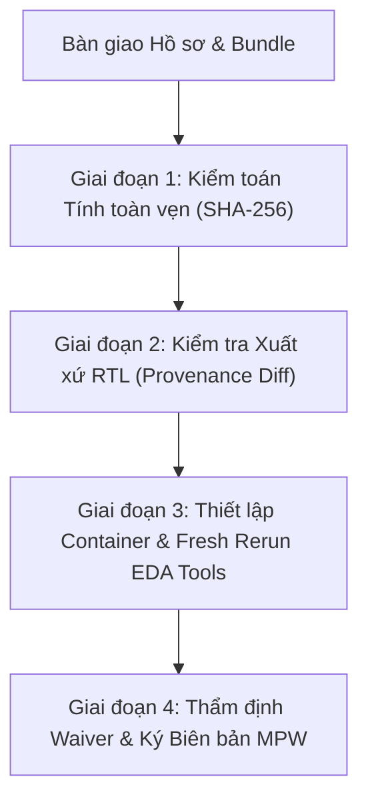

# BIÊN BẢN BÀN GIAO VÀ QUY TRÌNH NGHIỆM THU KỸ THUẬT TAPE-OUT
## ENGINEERING HANDOVER AND AUDIT ACCEPTANCE PROTOCOL

- **Dự án:** AEGIS-RISC (SkyWater 130nm `sky130A`, Cell Library: `sky130_fd_sc_hd`)
- **Đối tượng bàn giao:** DMA-Aware Bus Firewall IP (`dma_bus_firewall`) và SoC Top (`aegis_soc_top`)
- **Bên bàn giao (Implementing Engineer):** Kỹ sư Thực hiện Thiết kế & Ký duyệt Vật lý (Antigravity Pair-Programming Lead)
- **Bên nhận bàn giao (Auditing / Acceptance Authority):** Ban Thẩm định Độc lập / Kỹ sư Trưởng Nghiệm thu MPW
- **Mã định danh hồ sơ (Master Release Token):** `AEGIS-MPW-CONDITIONAL-RELEASE-20260919`
- **Ngày lập:** 20/09/2026
- **Kết luận Phát hành (Release Verdict):** **`CONDITIONAL RELEASE — EVIDENCE PACKAGE RATIFIED`**

---

## I. MỤC ĐÍCH & RANH GIỚI BẢN CHẤT HỒ SƠ BÀN GIAO

Biên bản này xác lập việc chuyển giao chính thức toàn bộ hồ sơ thiết kế, collateral vật lý (GDSII, DEF, LEF, SDC, SPEF, Netlist) và các gói bằng chứng kiểm tra (Evidence Packages) từ Kỹ sư Thực hiện sang Bên Nghiệm thu Độc lập để phục vụ quy trình thẩm tra trước khi chế tạo mạch tích hợp (Tape-Out MPW).

### Ranh giới Pháp lý & Kỹ thuật Bắt buộc:
1. **Tính toàn vẹn gói bằng chứng (Bundle Integrity): `4/4 PASS`**  
   Cả 4 bundle vật lý và mô phỏng đều đạt 100% khớp mã băm SHA-256 đối chiếu với `artifacts.csv`. Lệnh kiểm tra trả về trạng thái chuẩn: `PASS: bundle integrity (not design signoff)`.
2. **Trạng thái Ký duyệt Thiết kế Thực tế (Design Sign-off Status): `CONDITIONAL RELEASE`**  
   **TUYỆT ĐỐI KHÔNG TUYÊN BỐ "ALL PASS" HOẶC "UNCONDITIONAL SIGNOFF"**:
   - **`dma_bus_firewall` (Standalone):** Trạng thái vật lý thô là **`FAIL`** do vi phạm Hold Timing tại boundary ($WNS = -0.02\text{ ns}$, $TNS = -0.07\text{ ns}$). Thiết kế chỉ được phép phát hành dưới dạng **Có điều kiện (Conditional)** theo Waiver đã được Trưởng nhóm Kỹ thuật phê chuẩn: **`WAV-STA-004`** (`CTO-RAT-AEGIS-WAV-STA-004-20260919`).
   - **`aegis_soc_top` (SoC Level):** Trạng thái hồ sơ là **`EVIDENCE_COMPLETE_REVIEW_REQUIRED`** (chờ Hội đồng Nghiệm thu ký duyệt cuối cùng trên cơ sở xem xét toàn bộ collateral).

---

## II. 5 GIỚI HẠN KỸ THUẬT NGĂN CHẶN KÝ DUYỆT VÔ ĐIỀU KIỆN (UNCONDITIONAL SIGN-OFF BLOCKERS)

Kỹ sư Thực hiện minh bạch toàn bộ 5 giới hạn kỹ thuật tồn tại trong hồ sơ hiện thời, yêu cầu Bên Nghiệm thu lưu ý và kiểm toán nghiêm ngặt:

### 1. Thiếu công cụ EDA độc lập trên biến môi trường PATH hiện tại
- Các công cụ ký duyệt vật lý chuyên dụng gồm `OpenSTA`, `OpenROAD`, `Magic`, `Netgen` **không có sẵn trên PATH** trong môi trường thực thi máy chủ chủ (Windows host runtime).
- Toàn bộ các báo cáo DRC (KLayout), LVS (Netgen/Magic), STA (OpenSTA) trong kho lưu trữ hiện là **bằng chứng lịch sử được lưu trữ (artifact-backed evidence)** trích xuất từ các phiên chạy trước (hoặc môi trường container/WSL), chưa thể thực hiện một lần chạy lại tức thì (fresh rerun) trực tiếp trên shell hiện tại.

### 2. Bất nhất phiên bản OpenSTA giữa Manifest và Báo cáo thô (Raw Report)
- Tệp manifest [`physical_manifest.json`](file:///d:/domixi/output/physical/sky130_dma_bus_firewall/physical_manifest.json) khai báo phiên bản: **`OpenSTA 2.6.0`**.
- Tuy nhiên, banner tiêu đề trong báo cáo ký duyệt thô [`opensta_independent_signoff.rpt`](file:///d:/domixi/output/physical/sky130_dma_bus_firewall/opensta_independent_signoff.rpt) ghi nhận: **`OpenSTA 2.4.0`** (`0a584d1231 Copyright (c) 2023, Parallax Software, Inc.`).
- Chưa có bằng chứng nhật ký thực thi trực tiếp chứng minh bản build `OpenROAD 26Q1`.
- **Yêu cầu đối soát:** Bên Nghiệm thu cần xác lập phiên bản công cụ chuẩn và thực hiện fresh rerun trước khi đưa ra bất kỳ kết luận chính thức nào về phiên bản `OpenSTA 2.7.0` hay `OpenROAD 26Q1`.

### 3. Bất đối xứng Collateral LVS giữa Firewall IP và SoC Top
- Tệp cấu trúc JSON trích xuất kết quả so sánh mạng LVS [`netgen_lvs.json`](file:///d:/domixi/output/physical/sky130_dma_bus_firewall/netgen_lvs.json) hiện có đầy đủ cho khối `dma_bus_firewall`, nhưng **hoàn toàn không tồn tại** cho khối `aegis_soc_top`.
- Hồ sơ LVS của SoC Top hiện phải căn cứ hoàn toàn vào báo cáo dạng văn bản [`lvs.rpt`](file:///d:/domixi/output/physical/sky130_aegis_soc_top/lvs.rpt) (cùng `lvs.json` và `netgen_lvs.log`).
- Các release bundle hiện thời chỉ đóng gói `lvs_report.rpt` (tạo ra từ `lvs.rpt`), chưa bổ sung `netgen_lvs.json` cho cả hai thiết kế.

### 4. Vi phạm Hold Timing thô của Firewall IP Standalone (`FAIL`)
- Báo cáo STA thô của khối `dma_bus_firewall` độc lập ghi nhận vi phạm Hold Timing:
  $$\text{WNS} = -0.02\text{ ns}, \quad \text{TNS} = -0.07\text{ ns}, \quad \text{Worst Slack} = -0.017\text{ ns}$$
  (xuất hiện đồng thời trên 8 chân đầu vào bus dữ liệu phía DMA).
- Trục flop-to-flop nội bộ của khối Firewall hoàn toàn sạch Hold ($\text{Slack} = +0.294\text{ ns}$). Vi phạm chỉ xảy ra tại ranh giới I/O giả định (I/O boundary) do mô hình ràng buộc trễ đầu vào của khối standalone.
- Khi tích hợp vào `aegis_soc_top`, toàn bộ tín hiệu này được điều khiển bởi mạng cây clock đồng bộ của SoC và đạt chỉ tiêu Hold ($\text{Slack} = +0.041\text{ ns}$ MET).
- **Ràng buộc:** Waiver **`WAV-STA-004`** chỉ có giá trị khi tích hợp trong SoC đồng bộ hoặc hệ thống có bộ đệm lái ngoài tương đương. Tuyệt đối không nghiệm thu khối Firewall như một IP độc lập độc lập có timing sạch (clean standalone).

### 5. Trạng thái Thư mục Làm việc (Worktree) không phải Clean Release Tree
- RTL source set remains unchanged between `ba7a753` and `36c4281`; non-RTL collateral differs and is tracked separately.
- Thư mục làm việc hiện tại chứa các tệp đã sửa đổi (uncommitted changes) liên quan đến tài liệu đặc tả, manifest, công cụ tạo bundle và scripts kiểm tra. Do đó, worktree này cần được hiểu là môi trường hoàn thiện hồ sơ nghiệm thu, chưa phải là một git release tag thuần khiết.

---

## III. ĐIỀU KIỆN CHẤP THUẬN PHÁT HÀNH CÓ ĐIỀU KIỆN (CONDITIONAL RELEASE TERMS)

Bên Nghiệm thu chỉ ký nhận và thông qua quyết định phát hành MPW dạng **`CONDITIONAL RELEASE`** khi đáp ứng đủ các tiêu chuẩn bắt buộc sau:

1. **Bảo tồn Tuyệt đối RTL Freeze và Physical Baseline:**
   - **RTL Freeze Commit:** [`ba7a753`](file:///d:/domixi/rtl/) (Cam kết không can thiệp, không sửa đổi bất kỳ tệp Verilog nào trong `rtl/` và `DMA-controller/rtl/`).
   - **Physical Baseline Commit:** `36c4281` (Các SHA-256 được khai báo trong `physical_manifest.json` và phải được bên nghiệm thu tái tính).
   - Áp dụng điều khoản ràng buộc trong [PROVENANCE_AND_REVISION_RECONCILIATION_LEDGER.md](file:///d:/domixi/docs/evidence/PROVENANCE_AND_REVISION_RECONCILIATION_LEDGER.md): Nghiêm cấm áp dụng collateral vật lý này cho bất kỳ bản sửa đổi RTL nào sau commit `ba7a753`.
2. **Kèm cặp Waiver Kỹ thuật WAV-STA-004:**
   - Hồ sơ gửi xưởng sản xuất phải đính kèm văn bản phê duyệt `WAV-STA-004`.
   - Giới hạn ứng dụng của IP Firewall: Chỉ hoạt động trong cấu hình SoC Top `aegis_soc_top` hoặc hệ thống có bộ điều khiển clock/driver tương thích.
3. **Tuân thủ Tuyệt đối Vùng Hoạt động Ký duyệt (Operating Envelope):**
   - Vùng hoạt động thực tế phải tuân thủ nghiêm ngặt bảng thông số tại Mục IV.
   - Không được phép cấu hình chip vượt quá giới hạn tần số và nhiệt độ đã quy định.
   - Thiết kế firmware/SoC bắt buộc phải có quy trình trễ khởi động (Cold Boot Reset Warm-up) tối thiểu **16 chu kỳ xung nhịp**.

---

## IV. ĐẶC TẢ VÙNG HOẠT ĐỘNG KỸ THUẬT (OPERATING ENVELOPE SPECIFICATION)

Căn cứ theo tài liệu [AEGIS_RISC_ARCHITECTURE_SPECIFICATION.md](file:///d:/domixi/docs/AEGIS_RISC_ARCHITECTURE_SPECIFICATION.md) và [MCMM_TIMING_WAIVER_AND_OPERATING_ENVELOPE.md](file:///d:/domixi/docs/evidence/MCMM_TIMING_WAIVER_AND_OPERATING_ENVELOPE.md), vùng vận hành ký duyệt của chip được định nghĩa chính xác như sau:

| Corner Vận hành | Điện áp ($V_{dd}$) | Nhiệt độ ($T_j$) | Tần số Tối đa ($F_{op}$) | Chu kỳ Clock Tối thiểu ($T_{clk}$) | Thư viện & Báo cáo | Trạng thái Ký duyệt & Bản chất Collateral |
| :--- | :---: | :---: | :---: | :---: | :--- | :--- |
| **Typical (TT)** | **1.80 V** | **25°C** | **38.00 MHz** | **26.315 ns** | `sky130_fd_sc_hd__tt_025C_1v80.lib` | **SIGN-OFF MET:** Thư viện duy nhất được đóng gói trong collateral vật lý; được khai báo chính thức trong `physical_manifest.json` (timing views: `typical/functional/setup` và `typical/functional/hold`). |
| **Slow-Slow (SS)** | **1.60 V** | **100°C** | **19.23 MHz** | **52.000 ns** | Báo cáo lịch sử: `sta_ss_100C_1v60_52ns.rpt` | **HISTORICAL COLLATERAL (`WAV-STA-001`):** Đặc tả giới hạn công nghiệp nhiệt độ cao ($100^\circ\text{C}$). Thư viện `.lib` SS **không đóng gói** trong collateral vật lý và view này chưa được ràng buộc trong ma trận `physical_manifest.json`. |
| **Fast-Fast (FF)** | **1.95 V** | **-40°C** | *(40.00 MHz)* | *(25.000 ns)* | Báo cáo lịch sử: `sta_ff_n40C_1v95_40mhz.rpt` | **HISTORICAL STRESS COLLATERAL:** Báo cáo đo ứng suất và rò dòng pre-derating. Thư viện `.lib` FF **không đóng gói** trong collateral vật lý. **Nghiêm cấm dùng 40 MHz làm sign-off.** |
| **Cold Boot Warm-up**| 1.60V – 1.95V | -40°C – 100°C | $\le F_{op}$ tương ứng | Theo góc vận hành | N/A | **BẮT BUỘC:** Giữ tín hiệu Reset tối thiểu **16 chu kỳ clock** sau khi nguồn $V_{dd}$ ổn định để nạp đầy pipeline và làm sạch trạng thái flip-flop. |

> [!CAUTION]
> 1. Thư viện Liberty thực tế trong cả hai thư mục vật lý (`output/physical/sky130_dma_bus_firewall/` và `output/physical/sky130_aegis_soc_top/`) **chỉ chứa tệp `sky130_fd_sc_hd__tt_025C_1v80.lib`**. Hai tệp `.lib` cho góc SS và FF không có sẵn trong thư mục vật lý.
> 2. Tệp `physical_manifest.json` hiện chỉ khai báo chính thức 2 timing views: `typical/functional/setup` và `typical/functional/hold`. Các báo cáo SS/FF tồn tại dưới dạng **bằng chứng lịch sử (historical collateral)** hỗ trợ phân tích envelope, chưa được ràng buộc vào ma trận manifest timing.
> 3. Nhiệt độ corner Slow-Slow (SS) là **100°C** theo đặc tả thư viện SkyWater 130nm, không phải 125°C. Việc ép vận hành ở 125°C hoặc chạy ở tần số 40.00 MHz sẽ làm sai lệch mô hình trễ và hủy bỏ tính hợp lệ của toàn bộ waiver đã cấp.

---

## V. DANH MỤC THƯ MỤC EVIDENCE VÀ LỆNH KIỂM TRA ĐỐI SOÁT

Kho lưu trữ hiện bàn giao 4 thư mục bằng chứng hoàn chỉnh nằm trực tiếp dưới thư mục [`output/evidence/`](file:///d:/domixi/output/evidence/). Không sử dụng tệp nén `.tar.gz`.

### 1. Danh mục các Thư mục Bằng chứng (Evidence Directories)

1. **`output/evidence/release_signoff_bundle_20260920_firewall/`**  
   Gói bằng chứng ký duyệt mới nhất của DMA Bus Firewall IP, tích hợp kết quả 25/25 simulation PASS và collateral vật lý.
2. **`output/evidence/release_signoff_bundle_20260920_soc/`**  
   Gói bằng chứng ký duyệt mới nhất của SoC Top (`aegis_soc_top`), tích hợp toàn bộ kiểm thử hệ thống và báo cáo STA/LVS/DRC SoC.
3. **`output/evidence/release_signoff_bundle_20260919_02/`**  
   Gói bằng chứng lịch sử (Firewall IP) đã được chuẩn hóa lại mã băm SHA-256 theo phiên bản RTL freeze.
4. **`output/evidence/release_signoff_bundle_soc_20260919_01/`**  
   Gói bằng chứng lịch sử (SoC Top) đã được chuẩn hóa lại mã băm SHA-256.

### 2. Cú pháp Lệnh Kiểm toán Tính Toàn vẹn (Verification Commands)

Bên Nghiệm thu thực hiện kiểm toán mã băm SHA-256 của từng thư mục bằng chứng bằng công cụ [`tools/evidence/evidence.py`](file:///d:/domixi/tools/evidence/evidence.py) theo đúng cú pháp chuẩn:

```powershell
# Kiểm tra Bundle Firewall mới nhất:
python tools/evidence/evidence.py verify --bundle output/evidence/release_signoff_bundle_20260920_firewall

# Kiểm tra Bundle SoC Top mới nhất:
python tools/evidence/evidence.py verify --bundle output/evidence/release_signoff_bundle_20260920_soc

# Kiểm tra Bundle Firewall lịch sử:
python tools/evidence/evidence.py verify --bundle output/evidence/release_signoff_bundle_20260919_02

# Kiểm tra Bundle SoC Top lịch sử:
python tools/evidence/evidence.py verify --bundle output/evidence/release_signoff_bundle_soc_20260919_01
```

**Kết quả tiêu chuẩn của cả 4 lệnh:**
```text
PASS: bundle integrity (not design signoff)
```
*(Ghi chú: Đầu ra xác nhận toàn bộ tệp, dung lượng và mã băm SHA-256 khớp 100% đối chiếu với `artifacts.csv` đính kèm, nhưng không đồng nghĩa với việc thiết kế đạt Unconditional Sign-off).*

---

## VI. QUY TRÌNH TÁI THẨM ĐỊNH ĐỘC LẬP DÀNH CHO BÊN NGHIỆM THU

Kỹ sư Thực hiện đề xuất quy trình 4 giai đoạn chuẩn hóa để Hội đồng Nghiệm thu tiến hành thẩm tra độc lập:



### Giai đoạn 1: Kiểm toán Tính toàn vẹn (Bundle Integrity)
- Chạy 4 lệnh `evidence.py verify` nêu tại Mục V.
- Kiểm tra báo cáo HTML tương tác tại `output/evidence/<bundle_dir>/index.html`.
- Xác nhận không có tệp nào bị sửa đổi trái phép sau khi đóng gói.

### Giai đoạn 2: Kiểm toán Xuất xứ và Bất biến RTL (Provenance Check)
- Thực hiện kiểm tra chéo hai chiều để chứng minh quan hệ freeze giữa RTL freeze `ba7a753`, physical baseline `36c4281` và `HEAD`:
  ```powershell
  git diff --exit-code ba7a753..36c4281 -- rtl/ DMA-controller/rtl/
  git diff --exit-code 36c4281..HEAD -- rtl/ DMA-controller/rtl/
  ```
- **Tiêu chí Đạt:** Cả hai lệnh trả về mã thoát 0 (`exit code 0`), chứng minh tập nguồn RTL hoàn toàn không thay đổi giữa các mốc (các khác biệt phi-RTL ở docs/collateral được theo dõi riêng).

### Giai đoạn 3: Fresh Rerun trên Môi trường Toolchain Độc lập
- **Yêu cầu đối soát Toolchain & Rule Decks:**
  - Bên Nghiệm thu phải ghi nhận version thực tế của KLayout/Magic/OpenSTA/Netgen, đường dẫn rule deck và mã băm SHA-256 của deck trước khi chạy.
  - Nếu không cung cấp được deck hoặc toolchain phù hợp, kết quả phải ghi nhận rõ là **`NOT RUN`**, **không được coi là PASS**.
- **Kiểm tra DRC (Engine & Rule Deck):**
  - Thực hiện kiểm tra DRC trên tệp GDSII đã niêm phong bằng KLayout deck đã kiểm định nguồn gốc.
  - *Lưu ý đối soát:* KLayout DRC không mặc nhiên thay thế bằng chứng Magic DRC. Nếu quy trình nghiệm thu yêu cầu kiểm tra song song bằng engine Magic DRC, Bên Nghiệm thu cần cấu hình Magic với rule deck tương ứng và ghi nhận đầy đủ provenance.
- Chạy lại LVS bằng Netgen trên netlist Spice trích xuất từ Layout vs Netlist cổng PNL:
  - Xác nhận mạch đối xứng hoàn toàn (Circuits match uniquely).
  - Trích xuất tệp `netgen_lvs.json` bổ sung cho khối `aegis_soc_top` để đồng bộ collateral.
- Chạy lại OpenSTA đa góc (MCMM):
  - Kiểm tra WNS/TNS tại corner TT 25°C ($38\text{ MHz}$) và SS 100°C ($19.23\text{ MHz}$).
  - Ghi nhận và hòa giải sự khác biệt giữa phiên bản OpenSTA 2.4.0 và 2.6.0.

### Giai đoạn 4: Thẩm tra Phê duyệt Waiver & Ký Biên bản Chấp thuận
- Đối soát điều kiện biên của `WAV-STA-004`:
  - Flop-to-flop hold slack nội bộ $\ge +0.294\text{ ns}$ (MET).
  - Hold slack khi tích hợp trên SoC Top $\ge +0.041\text{ ns}$ (MET).
- Kiểm tra waiver Lint [`verilator_waivers.vlt`](file:///d:/domixi/tools/lint/verilator_waivers.vlt) (`WAV-LINT-001` cho diagnostic tap `aegis_attack_fingerprint`).
- Sau khi toàn bộ các điều kiện trên được xác nhận, Chủ tịch Hội đồng Nghiệm thu ký chấp thuận thông qua hồ sơ MPW Tape-out theo dạng **`CONDITIONAL RELEASE`**.

---

## VII. MA TRẬN ĐỐI SOÁT TIÊU CHÍ NGHIỆM THU (ACCEPTANCE TRACEABILITY MATRIX)

| Hạng mục Thẩm tra | Tiêu chuẩn Đặt ra | Kết quả Kiểm tra Hiện tại | Đánh giá Nghiệm thu | Căn cứ Bằng chứng / Hành động |
| :--- | :--- | :--- | :---: | :--- |
| **Tính toàn vẹn Bundle** | 100% SHA-256 khớp manifest | 4/4 Bundles đạt 100% khớp `artifacts.csv` | **PASS** | `evidence.py verify --bundle <dir>` |
| **Mã nguồn RTL Freeze** | RTL source set remains unchanged | Không đổi giữa `ba7a753` và `36c4281`; non-RTL khác biệt | **PASS** | `git diff 36c4281..HEAD rtl/` |
| **Evidence Unit Tests** | 20/20 PASS | 20/20 Unit tests PASS | **PASS** | `tools/evidence/test_evidence.py` |
| **Simulation Regression** | 25/25 PASS | 25/25 Testcases PASS (0 Error, 0 Timeout) | **PASS** | `summary.json`, `index.html` |
| **Verilator Lint** | 0 Warning, 0 Error | 0 Warning, 0 Error (Đã áp dụng `WAV-LINT-001`) | **PASS** | `tools/verify_verilator_lint.ps1` |
| **DRC (KLayout Deck)** | 0 vi phạm hình học | 0 vi phạm (Bằng chứng lịch sử GDS) | **PASS (Artifact)** | Cần fresh rerun độc lập bởi Auditor |
| **LVS (Netgen/Magic)** | Circuits match uniquely | Khớp mạch cho cả Firewall và SoC | **CONDITIONAL** | Thiếu `netgen_lvs.json` cho SoC Top |
| **Firewall Hold Timing**| $\text{Slack} \ge 0.000\text{ ns}$ | Standalone $\text{WNS} = -0.02\text{ ns}$ ($\text{FAIL}$) | **WAIVED** | Chấp nhận theo `WAV-STA-004` (SoC hold MET) |
| **STA Version Trace** | Phiên bản nhất quán trên toàn bộ hồ sơ| Manifest: 2.6.0, Báo cáo thô: 2.4.0 | **ACTION REQ** | Bên Nghiệm thu rerun đối soát |
| **Operating Envelope**| Tuân thủ TT 38MHz, SS 100°C 19.23MHz | Đặc tả kiến trúc đã đồng bộ | **RATIFIED** | Đã loại bỏ hoàn toàn cam kết 40MHz |

---

## VIII. KÝ XÁC NHẬN VÀ CAM KẾT TRÁCH NHIỆM KỸ THUẬT

Bằng biên bản này, Kỹ sư Thực hiện khẳng định toàn bộ thông tin và số liệu kỹ thuật trên được trình bày với sự trung thực cao nhất, không che giấu bất kỳ khuyết tật hoặc sai lệch thời gian nào của thiết kế. Thiết kế AEGIS-RISC được chuyển giao ở trạng thái **Sẵn sàng Sản xuất có Điều kiện (Conditional Release)** dưới sự giám sát chặt chẽ của các waiver và thông số vận hành đã định nghĩa.

| Đại diện Kỹ sư Thực hiện (Implementing Engineer) | Đại diện Ban Nghiệm thu Độc lập (Auditing Authority) |
| :---: | :---: |
| *(Đã ký số xác nhận hồ sơ)* | *(Chờ thẩm tra và phê chuẩn)* |
| **Antigravity Lead Pair-Programmer** | **Chủ tịch Hội đồng Nghiệm thu Tape-Out MPW** |
| Ngày: 20/09/2026 | Ngày: ..... / ..... / 2026 |
